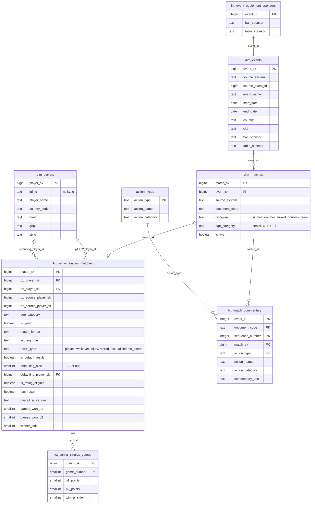

# Database & Multi-Source Warehouse Design

This document defines the target schema layout, surrogate key strategy, match data quality rules, and multi-source integration pattern for `table-tennis-analytics`. Current work focuses on **WTT + ITTF enrichment**, while keeping every mart ready for future national/team leagues (France Pro A, Germany TTBL, Japan T.League, Poland Superliga, MLTT).

Implementation is scheduled in `plans/warehouse-build-plan.md`. Where this document and the plan disagree, fix both.

---

## 1. Schema & Folder Separation (`level_source` Everywhere)

Both **Postgres schemas** and **dbt model folders** strictly follow **`level_source`** (layer first, source second). Each source/league owns its own isolated vertical slice, plus a unified `marts` schema ("marts of marts") on top:

| Layer | Postgres Schema (`level_source`) | dbt Folder (`level/source`) | Materialization | Purpose |
|---|---|---|---|---|
| **Raw / Landing** | `ingest_wtt`, `ingest_ittf`, *(future)* `ingest_pro_a`, `ingest_ttbl`, `ingest_tleague`, `ingest_superliga`, `ingest_mltt` | *(Python collectors + `db/migrations/`)* | Tables | Raw API JSONB payloads, operational `_unpacked` tables, pending-queue views, and (WTT) the `ingest_runs` history. |
| **Seeds** | `seeds` | `dbt/seeds/` | Tables | User-editable CSVs auto-loaded on `make dbt-run`. |
| **Staging** | `staging_wtt`, `staging_ittf`, *(future)* `staging_<league>` | `dbt/models/staging/wtt/`, `dbt/models/staging/ittf/`, `dbt/models/staging/<league>/` | Views for thin models (`staging_ittf`); **tables for anything that expands JSONB** (all WTT staging) | 1:1 with raw tables: type casting, trimming, null normalization, column pruning, and parsing of codes embedded in IDs. |
| **Intermediate** | `intermediate_wtt`, *(future)* `intermediate_<league>` | `dbt/models/intermediate/` | Tables / Views | Source-scoped enrichment & match-cleaning models (`int_event_equipment_sponsors`, `int_wtt_senior_singles_games`, `int_wtt_senior_singles`). |
| **Source Marts** | `marts_wtt`, `marts_ittf` *(view)*, *(future)* `marts_<league>` | `dbt/models/marts/wtt/`, `dbt/models/marts/ittf/`, `dbt/models/marts/<league>/` | Tables *(views for lightweight enrichment like `marts_ittf`)* | Clean, source-scoped business entities (`marts_wtt.dim_events`, `dim_players`, `dim_matches`, `fct_senior_singles_matches`, `fct_senior_singles_games`, `fct_match_commentary`; `marts_ittf.dim_player_profiles`). |
| **Unified Marts** | `marts` | `dbt/models/marts/core/` | **Views** until a second league exists, then re-evaluate | "Marts of marts": `UNION ALL`s source marts into `marts.dim_events`, `dim_players`, `dim_matches`, `fct_senior_singles_matches`, `fct_senior_singles_games`, `fct_match_commentary`. |

> **dbt note — schema names**: Set `+schema:` per folder in `dbt_project.yml` and add a 5-line `dbt/macros/generate_schema_name.sql` macro so dbt writes to `staging_wtt`, `marts_wtt`, `marts_ittf`, `marts`, etc. literally instead of prefixing them with the profile schema. The macro returns `target.schema` when no custom schema is set and `custom_schema_name | trim` otherwise. The profile's default schema is `dbt_default`; every model sets `+schema`, so that schema stays empty (a test asserts it).

> **dbt note — model names must be unique project-wide.** dbt resolves `ref('dim_events')` by file name, regardless of schema, so `marts/wtt/dim_events.sql` and `marts/core/dim_events.sql` cannot coexist. Name the files `wtt__dim_events.sql` and `core__dim_events.sql` and set `config(alias='dim_events')` so the tables keep clean names. Use the same `<source>__<name>` prefix for every mart with a unified twin.

> **dbt note — sources**: name dbt sources after the source system: `source('wtt', 'match_details_raw')` reads `ingest_wtt`, `source('ittf', 'ittf_player_profiles')` reads `ingest_ittf`.

> **dbt note — sqlfluff** cannot see custom macros unless `.sqlfluff` has `[sqlfluff:templater:jinja] load_macros_from_path = dbt/macros`.

---

### Raw-layer control tables

- **`ingest_wtt.ingest_runs`** — append-only record of every WTT fetch attempt (success or failure). It is local to the source: each source owns its own history. The `endpoint` column names the API endpoint (e.g. `wtt_eventcalendar`). ITTF profiles come from a CSV seed and have no run history; a future league adds `ingest_<league>.ingest_runs`.
- **`public.schema_version`** — the migration ledger (version, checksum, applied_at). Migrations are one numbered sequence for the whole database, so there is one ledger, and it belongs to no source. Migrations create `ingest_wtt` and `ingest_ittf` themselves, so a freshly created test database needs no bootstrap script.

> **Presentation layer:** The Streamlit presentation layer reads Zstandard-compressed Parquet snapshots in `app/data/` exported from `marts.*` via `make app-refresh` (see [ADR 0014](adr/0014-parquet-snapshots-for-streamlit-deployment.md)), never querying `ingest_*` or `staging_*` directly.

---

## 2. Deterministic Surrogate Keys (`_sk` — Your Own IDs)

### Plain-English Glossary
- **Natural Key**: The ID(s) that an upstream website or API gives you (e.g., WTT's `event_id` + 34–42-char `document_code`, or an `ittf_id`). Natural keys differ across leagues, can be long strings, and can collide (e.g., WTT event `100` vs. Pro A event `100`).
- **Surrogate Key (`_sk`)**: Your **own warehouse-generated ID** (`event_sk`, `match_sk`, `player_sk`) used as the primary key and foreign key across all marts. Raw natural keys are still kept as normal columns for debugging/traceability.
- **Deterministic Hash**: Instead of an auto-increment counter (`1, 2, 3...`, which changes whenever you rebuild tables), we hash `source_system || '|' || natural_key` with `md5` into a 60-bit positive `BIGINT`. The **exact same input always produces the exact same number** on every `dbt run`.
- **Why no backfilling is needed**: Because `marts_wtt` and unified `marts` both compute `_sk` using the same dbt macro, the IDs automatically match everywhere—you **never** write `_sk` back into `ingest_*` (raw stays untouched per ADR 0004).

Recommended Postgres expression (positive 60-bit `bigint` — 8 bytes, fast to index & join, reproducible across `dbt run`s). Verified to return a positive value; collision probability at 1M keys is about 4×10⁻⁷:

```sql
('x' || left(md5(source_system || '|' || natural_key), 15))::bit(60)::bigint
```

**Implement it as a macro that casts every part to `text`** so `123::bigint` and `'123'` always hash the same. A NULL part yields a NULL key, which a `not_null` test then catches:

```sql

('x' || left(md5({{ source_system }}::text
   || '|' || {{ p }}::text), 15))::bit(60)::bigint

```

Every `_sk` column gets `unique` and `not_null` tests. They also catch dedupe bugs.

| Entity | Surrogate Key | Natural Key Input | Kept Source Attributes |
|---|---|---|---|
| **Event** | `event_sk` | `source_system \|\| '\|' \|\| source_event_id` | `source_system`, `source_event_id` |
| **Match** | `match_sk` | `source_system \|\| '\|' \|\| source_event_id \|\| '\|' \|\| source_match_key` | `source_system`, `source_event_id`, `document_code` (WTT) / `source_match_id` |
| **Player** | `player_sk` | `coalesce('ittf\|' \|\| ittf_id, source_system \|\| '\|' \|\| source_player_id)` | `ittf_id` (nullable), `source_system`, `source_player_id` |
| **Source player** | `source_player_sk` | `source_system \|\| '\|' \|\| source_player_id` | Stable even after identity resolution |

### Player key gotchas
- **WTT `player_id` already is the ITTF ID.** Hash WTT players as `'ittf|' || player_id` (not `'wtt|'`) through a dedicated `player_sk()` macro, so a league player with the same ITTF ID lands on the same key.
- **`player_sk` changes when identity is resolved.** A league-only player keyed by `source_system|source_player_id` gets a new `player_sk` once linked to an ITTF ID or by override. So **facts carry both**: a permanent `p1_source_player_sk`/`p2_source_player_sk`, and `p1_player_sk`/`p2_player_sk` looked up through `int_player_identity_map` at build time. Never store `player_sk` anywhere outside the marts. Ratings (Glicko-2) are always recomputed from scratch.

> **Why this helps `fct_match_commentary`**: keeping `match_sk` on `dim_matches`, `fct_senior_singles_matches` and `fct_match_commentary` turns a composite `(event_id, document_code)` string join into a single `bigint` join. Commentary also covers doubles and team matches, so it references `dim_matches` (all disciplines), not `fct_senior_singles_matches`.

---

## 3. Master Player List & Identity Resolution (`dim_players`)

National leagues (e.g. France Pro A) include players without an `ittf_id` and also provide extra attributes (`hand`, `style`). Player resolution is handled in two explicit steps:

1. **`int_player_identity_map`** (crosswalk): maps `(source_system, source_player_id)` -> `player_sk` with `match_method`:
   - `ittf_id` (exact ID match)
   - `exact_name_country_dob` (never auto-merge on name alone — avoids colliding common names)
   - `manual_override` (from a user-editable seed `dbt/seeds/player_identity_overrides.csv`)
   - `source_only` (unmatched league-only player)
2. **`dim_players`** (master list, 1 row per `player_sk`):
   - `ittf_id` is **nullable** (not the PK).
   - Attributes are merged by source priority (e.g. `coalesce(ittf.hand, pro_a.hand)`, `coalesce(ittf.style, pro_a.style)`).

**Identity edge cases (observed or expected)**
- **Name collisions & duplicate ITTF IDs (`assert_wtt_dim_players_name_collisions`)**: 11 exact `(player_name, country_code)` collisions are surfaced as a dbt warning in `marts_wtt.dim_players`:
  - **7 distinct-player groups (different DOBs)**: `LEE Yubin`, `LEE Daeun` (3 rows), `LEE Junho` (KOR); `Juan GONZALEZ`, `Boris VILLAVICENCIO` (ECU); `Francisco LOPEZ` (VEN); `Sara STOJANOVSKA` (MKD).
  - **4 likely duplicate ITTF IDs (left unmerged for now; ITTF site heavily rate-limits manual ID lookups)**: `Anja HANDEN` (SWE: `202486`, `218792`, matching DOB), `Luca KUMAHARA` (BRA: `113418` F / `206781` M, matching DOB), `Natalia PARTYKA` (POL: `107177`, `214830`, matching DOB), and `Merve DEMIR` (TUR: `131677` vs `217412`, possible DD/MM swap in DOB).
- League data often has no date of birth, so `exact_name_country_dob` will rarely match league players. Expect many `source_only` rows and rely on overrides.
- Expect romanisation variants (`Yun-Ju` / `Yunju`), family-name-first ordering, accents, players changing association, and married-name changes.
- Use `pg_trgm` (already installed) to **suggest** candidate pairs for the overrides CSV, never to merge automatically.
- 3,426 WTT players have no ITTF profile: `hand`, `grip`, `style` are legitimately NULL for them.
- `player_identity_overrides.csv` points at `target_ittf_id` or a target `(source_system, source_player_id)`, never at a pasted `_sk` hash.

---

## 4. Handling Different Match Formats (e.g. MLTT)

To support best-of-5/7 (WTT/leagues) alongside fixed-set/point formats (MLTT) in one `fct_senior_singles_matches` table:
- Add `match_format` (`'best_of_5'`, `'best_of_7'`, `'fixed_3_sets'`, etc.) and `scoring_rule` (`'games_won'`, `'points_won'`).
- Derive WTT's `match_format` from `matchConfig.bestOfXGames` (not `bestOf`, which does not exist upstream), and record `max_points_per_game`, `advantage_per_game` and `sudden_death_point` from the same object.
- Store `games_won_p1` / `games_won_p2`, `points_won_p1` / `points_won_p2`, and `winner_side` (`1`, `2`, or `null` for draw).
- A draw gives `winner_side = NULL`, which looks the same as "no result". Distinguish them with `result_type` and `has_result`, and only apply `not_null` tests where a result is expected.
- Standard best-of analysis simply filters `where match_format like 'best_of_%'`.

---

## 5. User-Editable Reference Seeds

Small, human-curated tables live locally in `dbt/seeds/` (gitignored; CI uses header-only stubs for `dbt parse`) and are **automatically reloaded** on every `make dbt-run`:
- `dbt/seeds/action_types.csv` - commentary action code labels and categories
- `dbt/seeds/sponsor_domains.csv` - bare website domain -> canonical brand name
- `dbt/seeds/event_sponsors_manual.csv` - verified table and ball sponsors per event (`make event-sponsors-sync` and `make event-sponsors-identify` via `yt-dlp`, `ffmpeg`, and Gemini Vision)
- `dbt/seeds/round_codes.csv` - raw round token -> normalized `round_code`, `round_stage`, and `round_order`
- `dbt/seeds/result_types.csv` - result status / score suffix -> `result_type`, `is_default_result`, and `is_rating_eligible`
- `dbt/seeds/match_format_overrides.csv` - tournament/discipline/round format overrides (e.g. Tokyo 2020, Paris 2024, Mixed Team World Cup)
- `dbt/seeds/match_score_overrides.csv` - verified per-match score fixes for frozen or corrupted upstream scores
- `dbt/seeds/player_profile_overrides.csv` - manual `hand`, `grip`, and `style` overrides synced via `make player-profile-overrides-sync`
- `dbt/seeds/player_identity_overrides.csv` - manual cross-source player links (currently empty until additional leagues land)

---

## 6. Target Marts ER Diagram



---

## 7. Current Build Order (WTT + ITTF Subset)

1. Raw layer: `ingest_wtt`, `ingest_ittf`, `public.schema_version`
2. dbt skeleton: `staging_*`, `intermediate`, `marts_*`, `seeds`; `int_event_equipment_sponsors` and its seeds
3. Keys and `dim_events` (deduplicated WTT events, `event_sk`, equipment sponsors)
4. `dim_players` (WTT + ITTF profile enrichment, `player_sk`, nullable `ittf_id`)
5. Match staging (`best_of`, result suffix, age category, discipline; see §10)
6. `dim_matches`, `fct_senior_singles_matches`, `fct_senior_singles_games`, and `match_sk` on `fct_match_commentary`
7. Unified `marts` views

---

## 8. Singles vs. Doubles Separation

- **Separate tables, not nullable partner columns**: `fct_senior_singles_matches` is **singles only** (`p1_player_sk` and `p2_player_sk`, both `NOT NULL`), keeping 1v1 ratings (Glicko-2) and head-to-head queries clean.
- **`NOT NULL` alone does not separate singles from doubles**, because player 1 is populated on both sides of a doubles match. The filter is `sub_event_type like '%Singles'` **and** both second-player IDs are NULL. `competitorType` is `H` on every row and is no help. Add a test asserting no `fct_senior_singles_matches` row has a second player.
- **Team events are not matches**: the 1,414 "Men's/Women's/Mixed/U15 Team" entries are whole ties with no match details. They stay in `dim_matches` (`discipline = 'team'`) but never appear in `fct_senior_singles_matches`.
- **Doubles deferred**: Doubles and mixed doubles will live in a separate `fct_doubles` table later when needed, sharing `dim_events`, `dim_players`, `dim_matches` and `match_sk` conventions without complicating `fct_senior_singles_matches`.

---

## 9. Reference Benchmarks & Inspirations

1. **JeffSackmann/tennis_MatchChartingProject & tennis_atp** (`github.com/JeffSackmann`) — Gold-standard racquet-sport separation between match-level results (`fct_senior_singles_matches`) and point-by-point logs (`fct_match_commentary`).
2. **dbt-labs/jaffle-shop & jaffle-shop-classic** (`github.com/dbt-labs/jaffle-shop`) — Canonical dbt structure across `staging/` (`stg_*`), `intermediate/` (`int_*`), and `marts/` (`dim_*`, `fct_*`) with YAML schema tests and documentation.
3. **alan-turing-institute/AIrsenal** (`github.com/alan-turing-institute/AIrsenal`) — Clean separation of raw fixture/result ingestion, relational DB storage, rating/strength estimation, and downstream modeling.
4. **sublee/glicko2 & ryankirkman/pyglicko2** (`github.com/sublee/glicko2`) — Lightweight Python reference implementations of Glicko-2 (`μ`, `φ`, `σ`) for chronological Polars passes over `fct_senior_singles_matches`.

---

## 10. Match Data Quality Rules

Match data is the hardest part to clean. These rules come from querying the live warehouse on 2026-11-18 (201,856 match entries, 22,600 non-empty match-detail payloads). Counts will drift as ingestion continues. Re-check them when a rule looks wrong.

### 10.1 Coverage: most matches have no score

| Fact | Value |
|---|---|
| Match entries | 201,856 |
| Match-detail rows in raw | 201,847 |
| Non-empty detail payloads (`!= '{}'`) | 22,600 (about 11%) |
| Singles entries with details, by group | about 11% in every age group, including senior |
| Matches with commentary | 67,953 |

- `fct_senior_singles_matches` takes **`stg_match_entries` as its grain** and **left-joins** details. An inner join would lose about 89% of matches.
- `has_result` is true only when a usable result exists. Rating and head-to-head queries filter on it.
- Match entries carry no scores (`full_results` is always `OFFICIAL` and means nothing).
- Commentary covers 3x as many matches as details. Deriving results from point-won (`PT`) actions could close the gap later. Not in scope yet.

### 10.2 Result types (default results are kept, never dropped)

The overall score is `"<games>-<games>"` optionally followed by a suffix. Parse the suffix into `result_type`:

| Suffix | `result_type` | Count (as of check) | Notes |
|---|---|---|---|
| *(none)* | `played` | 22,065 | Normal result. Includes the 11 `LIVE` and 12 `0-0` rows, which are reclassified (see below and §10.3) |
| `WO` | `walkover` | 524 | Upstream fabricates `11-0,11-0,11-0` game scores |
| `INJ` | `injury` | 8 | Mixed: some have real partial scores, some fabricated `11-0` |
| `RET` | `retired` | 1 | Real partial scores |
| `DSQ` | `disqualified` | 2 | Fabricated `0-11` games |
| *(none, `0-0`)* | `no_score` | 12 | `OFFICIAL` but `0-0`; no usable result |

**All default results stay in `fct_senior_singles_matches`** so they can be analysed (who receives or causes the most walkovers, injuries, retirements and disqualifications). Columns:

- `result_type` — as above.
- `is_default_result` — true for `walkover`, `injury`, `retired`, `disqualified`.
- `defaulting_side` (`1` or `2`) and `defaulting_player_sk` — the **loser** of a default result. *For:* count a player's wins by default. *Against:* count a player's `defaulting_player_sk` rows. **Assumption to verify with a sample before trusting it:** the loser is the player who withdrew, was injured or was disqualified.
- `is_rating_eligible` — false for every default result and for `no_score`. This is a **flag, not a filter**, so Glicko-2 selects on it and the other analyses can ignore it.
- `overall_score_raw` — the original score text, kept verbatim, including the suffix.

**Defaults have no trustworthy game or point scores:**
- `games_won_p1/p2` and `points_won_p1/p2` are **NULL** for default results; `winner_side` is still set from the numeric score.
- `fct_senior_singles_games` contains `played` matches only. The 9 `INJ`/`RET` matches with partial real scores are deferred.
- **`comp_1_scores` / `comp_2_scores` must not be used.** They disagree with `results_game_scores` on defaults (e.g. `0-3 INJ` has comp scores `5,0,0` and game scores `5-11,7-11,0-11`). `results_game_scores` is the single source of truth.
- Strip the `0-0` padding games (every match is padded to 5 game slots).

### 10.3 `LIVE` matches are excluded

- 11 rows in `match_details_raw` have `resultStatus = 'LIVE'`, captured mid-match (e.g. `2-3` in game 5), so their scores are incomplete.
- **Excluded** from `fct_senior_singles_matches` and `fct_senior_singles_games`.
- **Kept in `dim_matches`** with `is_live = true`, so `fct_match_commentary.match_sk` still resolves.
- A **warn-level** dbt test reports the `LIVE` count, so a growing number is visible.
- Ingestion follow-up (ADR 0004: queues derive from raw, never from dbt): re-fetch `LIVE` payloads so they flip to `OFFICIAL`.

### 10.4 Age category

Singles are not all senior. 82% of singles entries (146,632 of 178,555) are youth. Age is only reliably encoded in the fixed-width `document_code`, since details exist for just 11% of matches.

- Regex: `^TTE[MWX](SINGLES|DOUBLES|TEAM)-+U([0-9]{2})` → `U` + group 2 (`U11`, `U13`, `U15`, `U17`, `U19`, `U21`). No match → `senior`.
- The trailing `8` in `U158FNL`, `U198FNL`, `U218FNL` is part of the round code, not the age.
- Columns: `age_category` (never NULL) and `is_youth`. Filter ratings by `age_category` deliberately: only about 20k singles matches have scores in total, and about 83% of them are youth.
- `sub_event_name` from details (e.g. `U19 Boys' Singles`) can cross-check the parsed value for the 11% that have it.

### 10.5 Other match edge cases

- **Side order is not random.** Competitor 1 wins about 62% (13,926 vs 8,651 non-default official matches), because the listed order tracks seeding/draw. `p1`/`p2` are ordered, not exchangeable. Rating code must use both orderings, or randomise, or model the order explicitly.
- **Game-level validity**: in a `played` match each game winner needs at least `max_points_per_game` (usually 11) and a lead of at least `advantage_per_game` (2). Pre-2001 games went to 21. Sudden-death sets (`suddenDeathPoint`, usually 99, meaning "none") may be capped. Start the test at `warn`.
- **Best-of consistency**: the winner's games-won must equal `ceil(best_of / 2)` for `played` matches.
- **Duplicate events**: events 2226 and 2227 are listed in both 2020 and 2021 payloads. Dedupe on `event_id`, latest `source_year`.
- **Event dates**: events range from 1926-12-06 to 2027-12-07. Future events have no matches (`has_matches = false`); guard `duration_days` when `start_date > end_date`.
- **`start_date_local` sentinel**: `0001-01-01T00:00:00` is already mapped to NULL in `stg_match_entries`.
- **Match IDs**: `id`/`iD` spelling variants exist upstream (1,641 rows use `iD`); `match_id` is not unique (ADR 0010). Identity is `(event_id, document_code)`.

### 10.6 Tests that guard these rules

| Test | Severity |
|---|---|
| `fct_senior_singles_matches` has no row with a second player on either side | error |
| `age_category` is never NULL | error |
| `match_sk`, `event_sk`, `player_sk` unique and not null | error |
| Derived games-won from `results_game_scores` equals numeric `overall_scores` for `played` | error |
| Winner reaches `ceil(best_of / 2)` games for `played` | error |
| Per-game score validity for `played` | warn first, then error |
| `LIVE` row count | warn |
| `result_type` in the allowed set | error |
